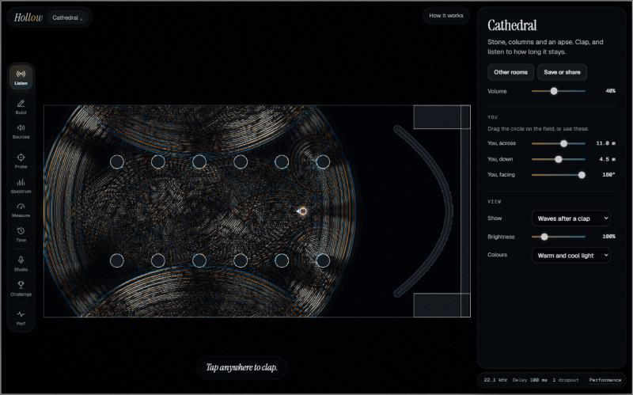
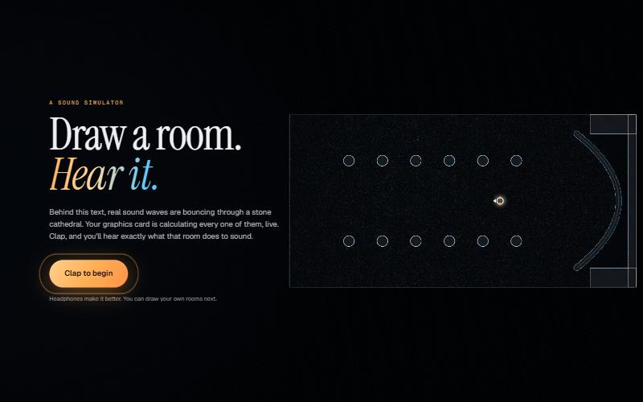
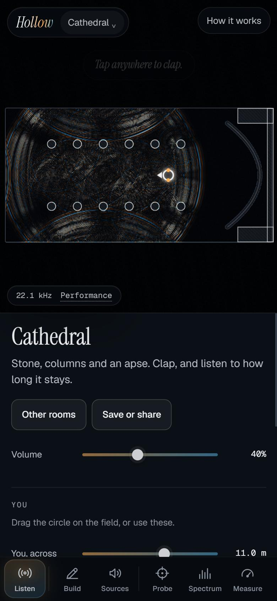

# Hollow

**Draw a room. Hear it.**

Hollow is a free sound simulator that runs in your browser. Draw walls, doors and columns, clap, and hear what that room does to sound: the echo, the muffled bass behind a closed door, the way sound bends around a corner.

None of that is an effect. Your graphics card solves the wave equation for the room you draw, tens of thousands of times a second, and the sound you hear is the air pressure at two grid cells beside your head. There is no reverb, panning, Doppler or occlusion code anywhere. Those all come out of the equation.

**This is a 2D simulation.** It behaves like a very tall room, with long low-frequency tails, so it will not match a real three-dimensional building. It's an instrument and a way to understand sound, not a tool for predicting real spaces.





## Try it

**Live demo:** https://yahelrosenblum.github.io/hollow/ (needs a browser with WebGPU: recent desktop Chrome or Edge. Headphones help.)

Or run it yourself. Needs Node 20 or later. There is nothing to install.

```bash
git clone https://github.com/yahelrosenblum/hollow.git
cd hollow
node serve.mjs
```

Then open http://127.0.0.1:8791 and press **Clap to begin**.

## Five things to try

1. **Clap in the Cathedral** and watch the wave bounce off the columns and gather in the curved end.
2. **Open "Next door" and shut the door.** The bass gets through and the highs stay behind.
3. **In Sources, press "Two opposed".** Two speakers cancel each other almost completely, until you step sideways.
4. **Open "Organ pipe" and hold to blow.** Drag the pipe shorter and the note rises.
5. **Open "Time mirror", clap, then rewind in the Time panel.** The sound gathers back to where it started.

## Who it's for

- People curious about how sound works, and teachers who want to show it. See [classroom ideas](docs/CLASSROOM.md).
- Musicians and sound designers looking for rooms to try, and impulse responses to export.
- Anyone who likes seeing real physics run live.

It works on a phone layout too:



**Feedback is the most useful contribution.** If a room sounds wrong, [open an issue](https://github.com/yahelrosenblum/hollow/issues/new/choose). See [CONTRIBUTING.md](CONTRIBUTING.md).

## What's in it

| Workspace | What it does |
|---|---|
| Listen | Clap, walk around the room, and turn your head. 12 built-in rooms. |
| Build | Walls, curves, freehand, boxes, ellipses, doors, windows and openings. Select, move, rotate, resize, duplicate, snap, measure, undo. Edits reach the solver while sound is ringing. |
| Sources | Up to 8 speakers with their own frequency, phase, delay and level, phase-locked to the solver. |
| Probe | Acoustic X-Ray: pressure, energy, direction of energy flow, frequency, material and nearby surfaces at any point. |
| Spectrum | Live left and right spectra, a waterfall, resonance detection, test tones, and a measured input-to-output response. |
| Measure | Decay time, room modes and a frequency response. Compare two versions of a room side by side. |
| Time | Pause, single steps, slow motion, reversal, recording and playback, and a refocus score. |
| Studio | Record, A/B dry and wet, export WAV and impulse responses, play audio files or your voice into the room, presets. |
| Challenge | 6 acoustic problems at 3 levels, scored only on what the simulation measures. |
| Perf | History of GPU time, simulation rate, delay and dropouts. |

Rooms autosave, survive a crash, and can be shared as a link. The link holds the whole room in the URL fragment, which browsers don't send to servers. Hollow has no backend, and nothing you make leaves your device. The only outside request is the page's fonts, which load from Google Fonts.

Press `?` for keyboard shortcuts. In the room, the arrow keys move a cursor and Enter acts at that spot.

## What happens to the sound

From the ear cells to your speakers there are exactly five steps. None of them adds echo or space.

1. A filter that flattens the frequency tilt of 2D propagation.
2. A blocker for constant pressure.
3. A filter at the edge of the grid's frequency range, because the grid itself rings there in any room.
4. A resampler up to your sound card's rate.
5. A safety limiter. Exports skip it.

## Known limits

- **Bandwidth.** Sound reaches about a quarter of the simulation rate, so 4 kHz at 16 kHz. It sounds darker than a recording. Compute grows with the cube of the rate, and Hollow steps down by itself if sound starts to drop out.
- **Time reversal** only works in lossless rooms, because undoing a loss amplifies rounding errors. Other rooms re-simulate from a checkpoint or show a recorded playback, and the screen always says which.
- **Foam** is a qualitative model. Its absorption rises with frequency as in real foam, but isn't calibrated to any product.
- **The reed** is a simple self-oscillating cell, not a model of a real reed's mechanics. It plays the pipe's own note, within 10% at every rate, but it can't predict how a real instrument would sound or start. At 22 kHz, pipes shorter than about half a metre don't start.
- **In a hidden tab with nothing audible,** the browser stalls audio and GPU work, so the simulation effectively pauses. It stays in step with the audio clock and resumes when the tab returns. While sound is playing, it keeps running.
- **Levels** are relative to the simulation, not sound pressure in the real world.
- **WebGPU is required.** There's no fallback, because nothing slower can compute sound in real time.

## Checking the physics

```bash
npm test
npm run audit
```

`audit.html` runs the GPU and audio checks in the browser. The browser gates in `tools/` drive the real app with injected input: load `tools/run-gates.browser.js` into a running page and read `window.hollowGates`, or `tools/soak.browser.js` for the 30-minute soak. `node tools/audit-report.mjs` writes the results to [docs/PHYSICS_AUDIT.md](docs/PHYSICS_AUDIT.md). That file only ever says what a run measured. [docs/DECISIONS.md](docs/DECISIONS.md) records the bugs the audit found, the design choices that followed, and every acceptance criterion that changed and why.

## How it's built

No dependencies and no build step: ES modules, WebGPU, WGSL and AudioWorklet.

- `src/sim`: the solver, its CPU twin, the real-time host, time control and offline measurement. Runs in a worker that owns the GPU device.
- `src/audio`: the audio thread, output chain, sources, WAV and impulse responses.
- `src/scene`: the room model, rasteriser, validation, storage, autosave and share links.
- `src/render`: the field renderer and palettes.
- `src/features`: one folder per workspace.
- `src/audit`, `tools`: the physics audit and browser test scripts.

Samples go straight from the worker to the audio thread, so a busy interface can't cause a dropout.

`artifact/index.html` is a copy of the page set up for publishing as a sandboxed claude.ai artifact, which can't save files, use a microphone or open share links.

## Background

The method is finite-difference time-domain (FDTD) simulation. Good starting points:

- Webb and Bilbao, [Computer Room Acoustics Using 3D FDTD](https://www.pure.ed.ac.uk/ws/files/12456157/Computer_Room_Acoustics_Using_3D_FDTD.pdf)
- Savioja, [Interactive Room Acoustic Simulation with FDTD](https://www.dafx.de/paper-archive/2010/DAFx10/Savioja_DAFx10_P43.pdf) (DAFx 2010)
- The [NESS project](https://www.epcc.ed.ac.uk/whats-happening/articles/ness-next-generation-sound-synthesis-project-bows-out) on physical-modelling sound synthesis
- Fink's work on time-reversal acoustics, which the Time panel demonstrates

## License

[MIT](LICENSE). Copyright (c) 2026 Yahel Rozenblum.
